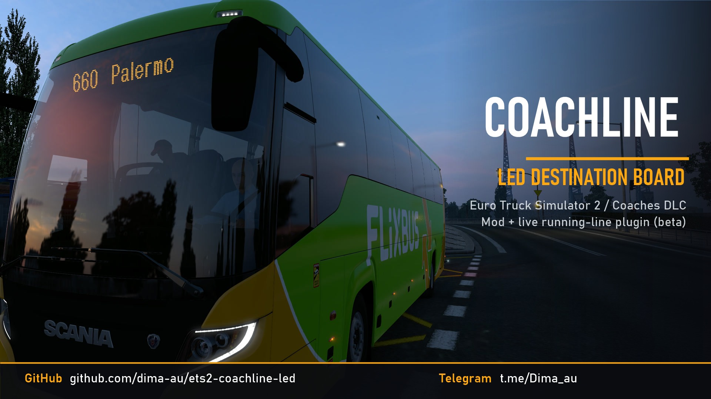
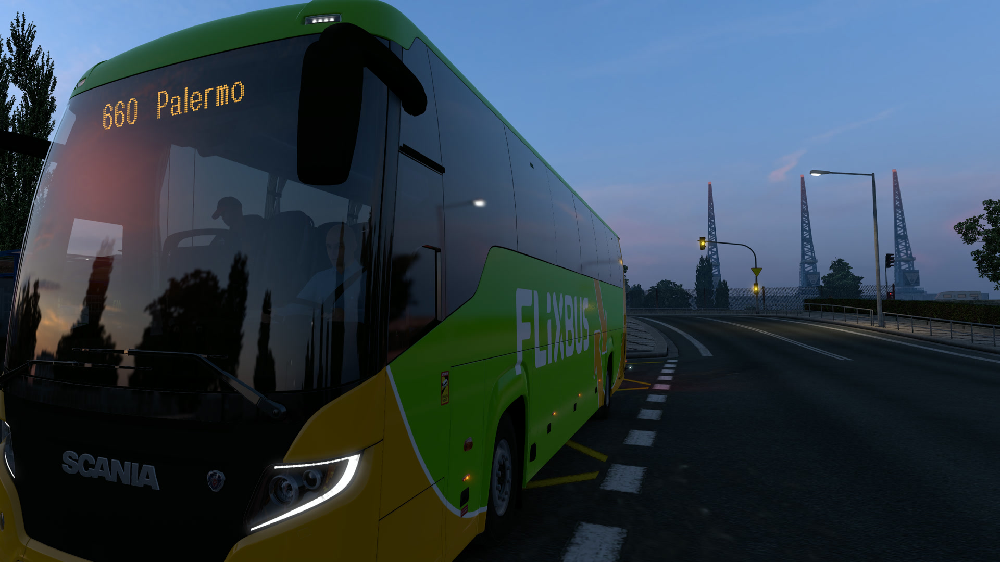
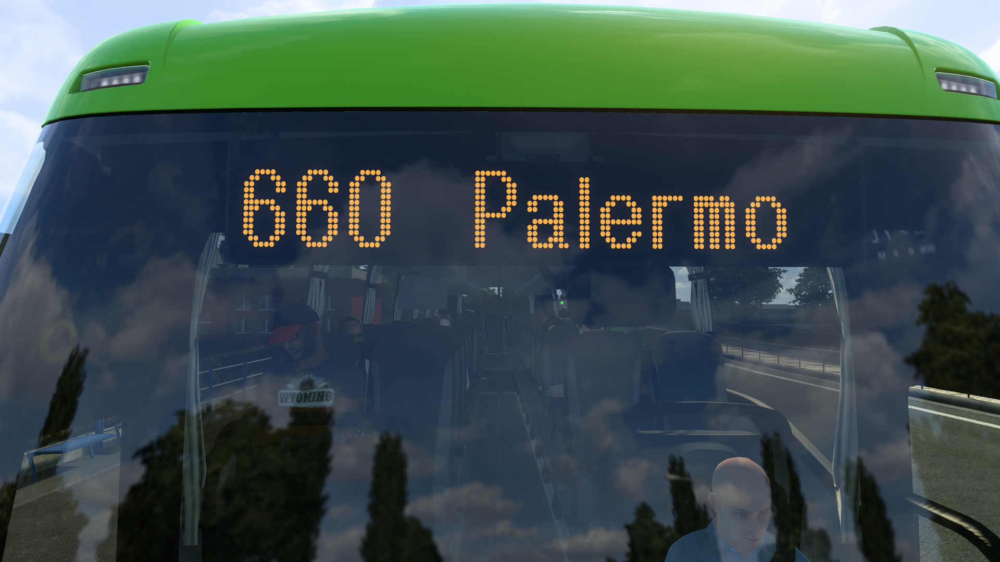
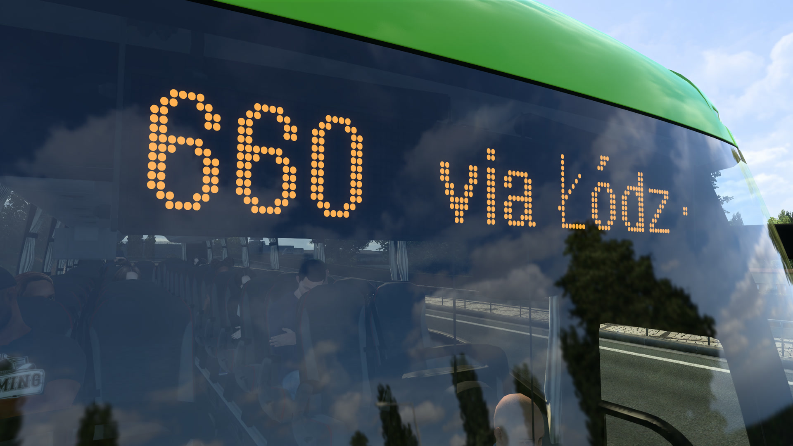
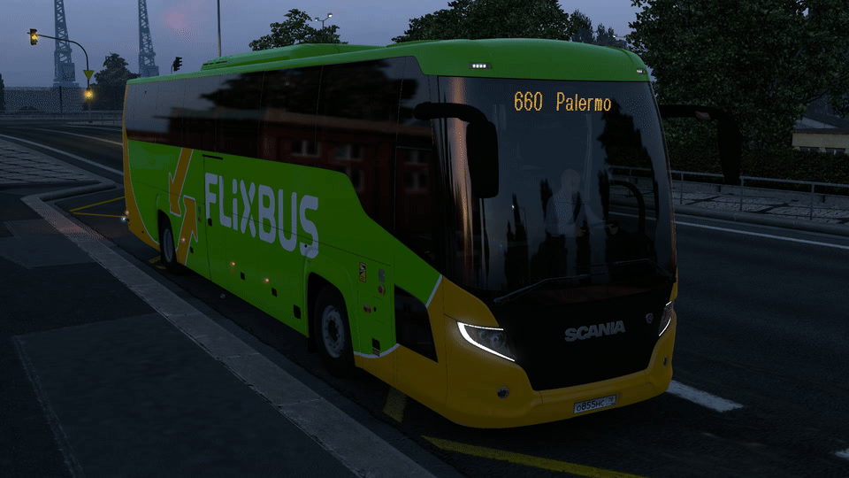
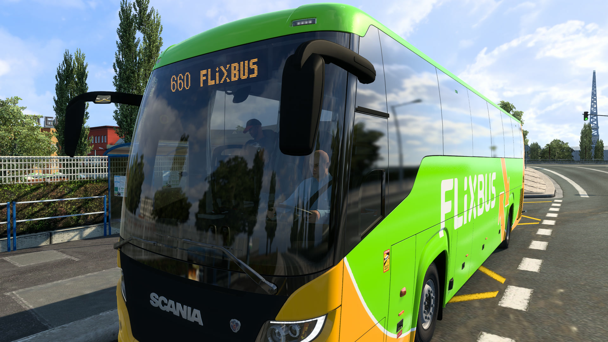

# Coachline: LED destination board (beta)

**Euro Truck Simulator 2 1.62 · Coaches DLC**

[Steam Workshop](https://steamcommunity.com/sharedfiles/filedetails/?id=3842891585) · Telegram: [t.me/Dima_au](https://t.me/Dima_au)

## EN

LED dot-matrix destination board for the Coaches DLC buses: 120 × 16 round amber dots, own LED font (Latin, Cyrillic, Greek).

With the `coachline_telemetry.dll` plugin the board shows your current job live:
- line number and destination;
- a "via …" running line with the stops in between;
- `N` for night departures;
- blank when there is no job.

**Compatibility:** Scania Touring works. MAN Lion's Coach (same board model) is not tested yet. **Volvo 9700 is not working yet, in progress.**

The plugin (DLL) is still in development, this is a beta. Without the DLL the mod shows a default strip.

### Install
1. Press the orange **DOWNLOAD** button at the top (or take the zip from [Releases](https://github.com/dima-au/ets2-coachline-led/releases/latest)).
2. Subscribe on [Steam Workshop](https://steamcommunity.com/sharedfiles/filedetails/?id=3842891585), or put `coachline_led_panel.scs` into `Documents\Euro Truck Simulator 2\mod\`; enable it in the Mod Manager.
3. Optional (running line): put `coachline_telemetry.dll` into `<game folder>\bin\win_x64\plugins\` (create `plugins` if missing). The game asks about third-party plugins on start, press OK.

## RU

Светодиодное табло маршрута для автобусов Coaches DLC: матрица 120 × 16 круглых янтарных точек, свой LED-шрифт (латиница, кириллица, греческий).

С плагином `coachline_telemetry.dll` табло показывает текущий рейс прямо в игре:
- номер линии и город назначения;
- бегущая строка «via …» с промежуточными остановками;
- `N` для ночных рейсов;
- без рейса табло гаснет.

**Совместимость:** Scania Touring работает. MAN Lion's Coach (та же модель табло) пока не проверен. **Volvo 9700 пока не работает, в процессе.**

Плагин (DLL) ещё в разработке, это бета. Без DLL мод показывает стандартную строку.

### Установка
1. Нажать оранжевую кнопку **СКАЧАТЬ** вверху (или взять zip в [Releases](https://github.com/dima-au/ets2-coachline-led/releases/latest)).
2. Подписаться в [Steam Workshop](https://steamcommunity.com/sharedfiles/filedetails/?id=3842891585) или положить `coachline_led_panel.scs` в `Documents\Euro Truck Simulator 2\mod\`; включить в менеджере модов.
3. По желанию (бегущая строка): `coachline_telemetry.dll` положить в `<папка игры>\bin\win_x64\plugins\` (создать `plugins`, если её нет). При запуске игра спросит про сторонние плагины, нажать OK.

## Screenshots

## Credits
- Bus livery in the screenshots: "Real Flixbus Skin" by AlxSim (Steam Workshop).
- LED font based on DotGothic16 (SIL Open Font License).

Not affiliated with SCS Software or FlixBus. Source code is not published; only the mod and the plugin binary.
